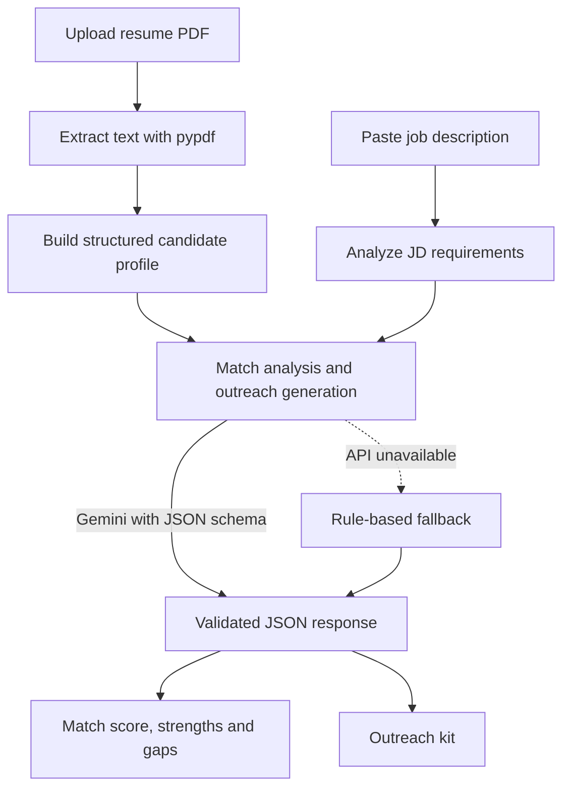

# ColdMail AI
 
**Resume-to-JD match analysis and personalized cold outreach, grounded only in facts from your resume.**
 
ColdMail AI reads your PDF resume, compares it with any job description, scores the match, points out your gaps, and writes ready-to-send emails and LinkedIn messages for recruiters, hiring managers and team members.
 
---
 
## Why this project
 
Most cold emails fail for two reasons: they are generic, and tailoring one for every job takes too long. General-purpose AI tools can make this worse by inventing skills, experience or connections that the candidate does not have.
 
ColdMail AI fixes both problems. Every message is generated only from facts found in your resume and the job posting, and the app shows you which fact supports each point.
 
## Features
 
- **PDF resume parsing:** extracts your name, education, skills, languages, frameworks, tools, projects and experience into a structured profile.
- **Job description analysis:** separates required skills from preferred skills and picks out the role, company and responsibilities.
- **Match score (0-100%):** with an evidence assessment explaining the score.
- **Strengths and gaps:** every requirement is marked as a strong match, a partial match or missing, so you know what to improve before applying.
- **Personalization Transparency Layer:** lists which project or skill from your resume backs each point in the messages.
- **Outreach kit:**
  - 3 subject lines
  - Recruiter email
  - Hiring manager email
  - Referral / team member message
  - LinkedIn connection note
  - LinkedIn follow-up message
- **Tone and length controls:** Professional, Friendly, Confident or Concise; Short, Medium or Detailed.
- **Regenerate and Make More Concise:** rewrite the messages without uploading your resume again.
- **Export:** copy any message, or download the whole kit as a `.txt` file.
- **Fallback mode:** if the AI service is unavailable or rate-limited, a rule-based engine still produces an analysis.
## How it works
 

 
1. The user uploads a PDF resume. The backend reads it in memory, so no file is stored on disk.
2. The user pastes a job description.
3. The backend sends the candidate profile and the JD to Gemini with strict rules that forbid adding outside facts. The model must reply in a fixed JSON format.
4. If the AI call fails, the rule-based fallback produces a comparable result.
5. The frontend shows the score, the strengths and gaps, the transparency layer and the outreach kit.
6. The user adjusts tone and length, regenerates, copies or exports.
## Tech stack
 
| Layer | Technology |
| --- | --- |
| Frontend | React 19, Vite 8, custom CSS, Lucide React icons |
| Backend | FastAPI (Python), Pydantic v2 |
| PDF parsing | pypdf |
| AI model | Google Gemini Flash (structured JSON output) |
| Fallback | Rule-based heuristic engine |
 
## API endpoints
 
| Method | Endpoint | Purpose |
| --- | --- | --- |
| POST | `/api/resume/upload` | Upload a PDF resume and get back the parsed candidate profile |
| POST | `/api/analyze` | Analyze a candidate profile against a job description and generate the outreach kit |
| POST | `/api/regenerate` | Regenerate messages with a new tone or length |
 
FastAPI also serves interactive API docs at `/docs` when the backend is running.
 
## Getting started
 
### Prerequisites
 
- Python 3.12 or newer
- Node.js 18 or newer
- A Google Gemini API key
### 1. Clone the repository
 
```bash
git clone https://github.com/<your-username>/<your-repo-name>.git
cd <your-repo-name>
```
 
### 2. Run the backend
 
```bash
cd backend
python -m venv venv
source venv/bin/activate        # On Windows: venv\Scripts\activate
pip install -r requirements.txt
```
 
Create a `.env` file in the `backend` folder:
 
```env
GEMINI_API_KEY=your_api_key_here
```
 
Start the server:
 
```bash
uvicorn main:app --reload
```
 
The API runs at `http://localhost:8000`.
 
### 3. Run the frontend
 
```bash
cd frontend
npm install
npm run dev
```
 
The app runs at `http://localhost:5173`.
 
> Folder names, the entry file (`main:app`) and the environment variable name above are placeholders. Change them to match your project.
 
## Screenshots
 
Add your screenshots to a `docs/screenshots` folder and reference them here:
 
| Upload and analyze | Match analysis |
| --- | --- |
|  |  |
 
| Outreach kit |
| --- |
|  |
 
## Project structure
 
```text
.
├── backend/
│   ├── main.py              # FastAPI app and routes
│   ├── schemas.py           # Pydantic models
│   ├── pdf_service.py       # PDF text extraction
│   ├── gemini_service.py    # Gemini calls and rule-based fallback
│   └── requirements.txt
├── frontend/
│   ├── src/
│   └── package.json
└── README.md
```
 
> Adjust this tree to match your actual folders.
 
## Limitations
 
- The match score is an AI estimate based on the text of your resume and the job description. Treat it as a guide, not a verdict.
- Resumes that are scanned images without selectable text may not parse correctly.
- Always read and edit the generated messages before sending them.
## Roadmap
 
- [ ] Chrome extension to import job descriptions from LinkedIn, Indeed and Greenhouse
- [ ] One-click sending through Gmail and Outlook
- [ ] A/B testing and response tracking for subject lines and tones
## Contributing
 
Contributions are welcome. Fork the repository, create a branch, make your changes and open a pull request.
 
## Author
 
**Priyanshi Singh**
 
- GitHub: [priyanshi-here](https://github.com/priyanshi-here)
- LinkedIn: [priyanshi-singh1806](https://www.linkedin.com/in/priyanshi-singh1806)
